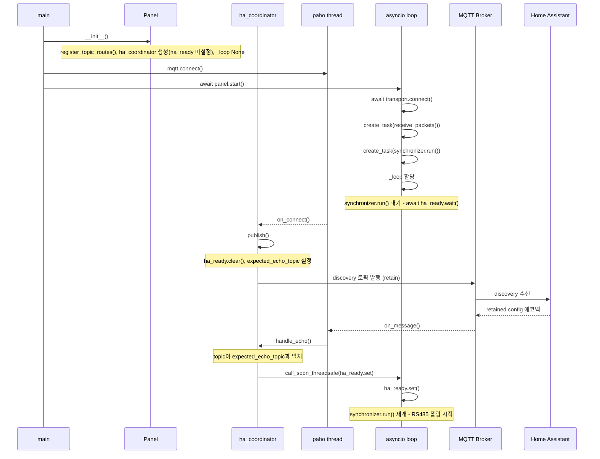
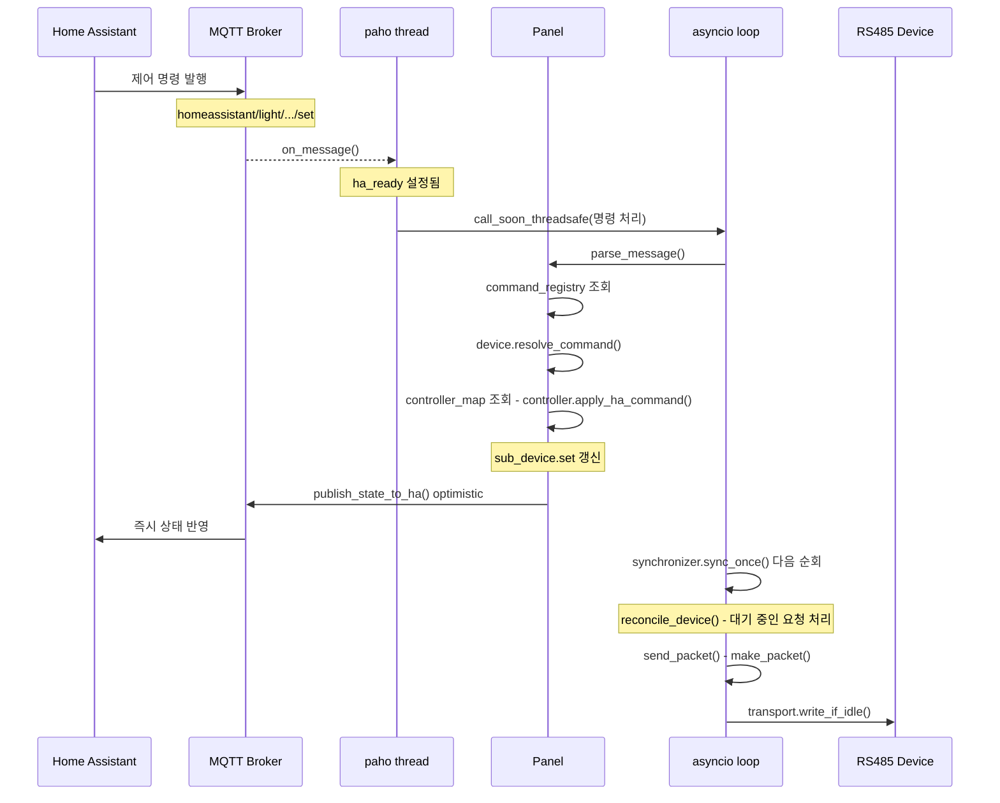
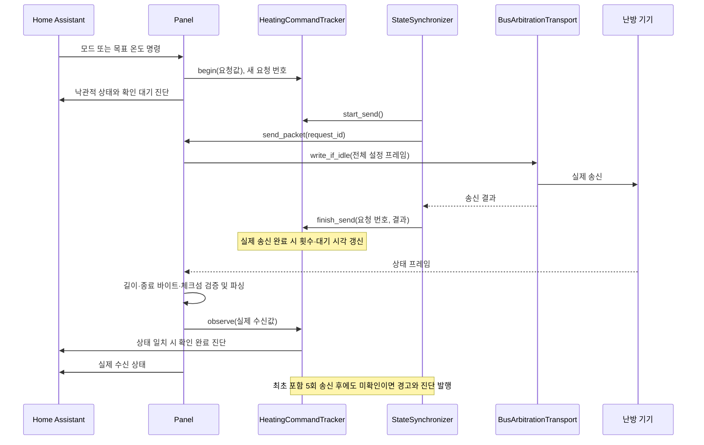
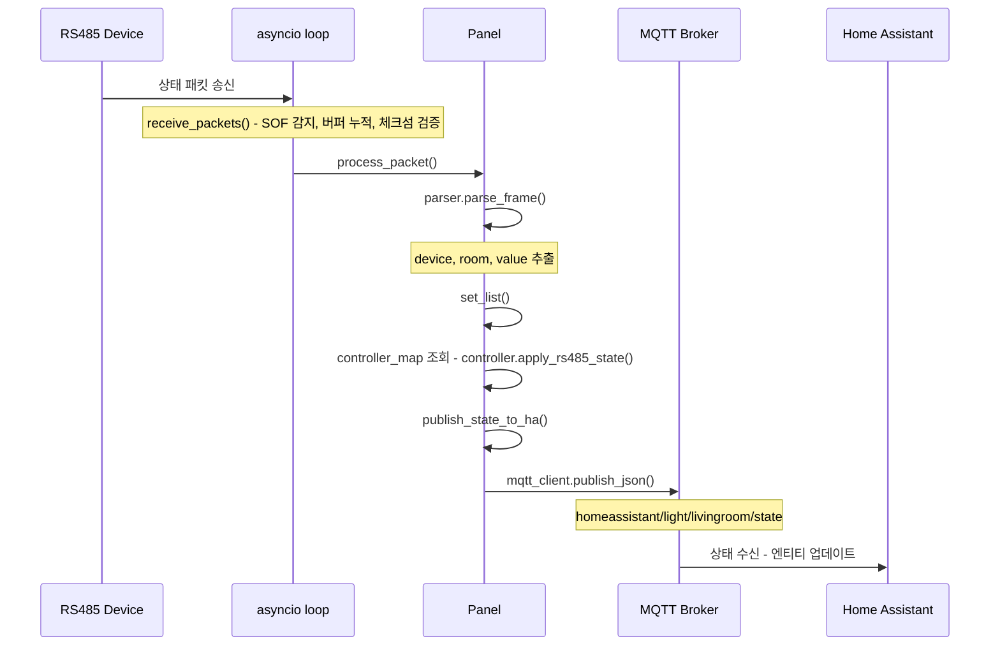

# 주요 시나리오 시퀀스 다이어그램

> **스레드 구분**
> - **paho thread**: MQTT 콜백(`on_connect`, `on_message`)이 실행되는 paho 내부 스레드
> - **asyncio loop**: `receive_packets()`, `StateSynchronizer.run()` 태스크가 실행되는 이벤트 루프 스레드

---

## 초기화

브릿지는 HA가 discovery를 확인하기 전까지 제어 명령 처리와 RS485 폴링을 차단한다.
`ha_ready`(`asyncio.Event`)가 그 게이트 역할을 한다.

---

## HA to Panel (제어 명령)

HA 제어 명령이 내려오면 대상 `CategoryController`가 목표 상태를 기록하고,
`StateSynchronizer` 다음 순회 시 RS485 패킷을 전송한다.

---

## 난방 명령 확인

난방 명령은 이벤트 루프에서 처리하며 `HeatingCommandTracker`가 방별 현재 요청을 추적한다.
`StateSynchronizer`는 필드별 전송 대신 모드·온도를 포함한 프레임을 한 번 전송한다.

HA 디버그 입력은 기기 응답 확인에서 제외한다. 송신 중 도착한 응답은 기록해 두었다가
송신 완료 결과와 함께 판정한다. 관측 기준점은 실제 쓰기 버퍼에 바이트를 넣은 직후
`on_write`로 갱신하고, 재연결 후 각 쓰기에서도 다시 갱신한다.
새 요청이 생기면 이전 송신 결과는 새 요청에 반영하지 않는다.
센서 토픽과 로그 추출 절차는 [난방 진단 가이드](heating_diagnostics.md)를 참조한다.

---

## Panel to HA (상태 모니터링)

RS485 버스에서 패킷을 수신하면 파싱 후 HA에 상태를 발행한다.

